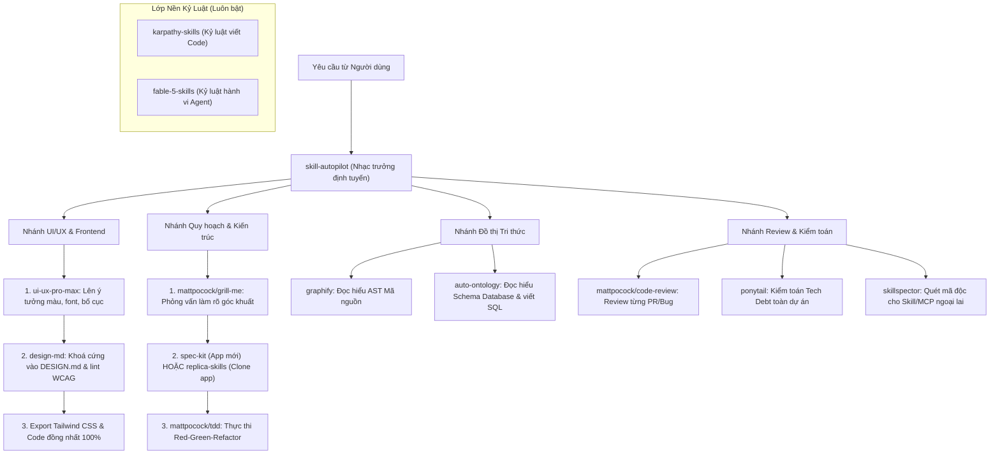

# 🤖 AGENTS.md — Hướng Dẫn Toàn Diện Cho AI Coding Agents (Mcsock-AI-repo)

> **Dành cho mọi AI Agent (Google Antigravity, Claude Code, OpenAI Codex, Cursor, Windsurf, GitHub Copilot, OpenCode):**  
> Khi người dùng trỏ bạn vào kho lưu trữ **`Mcsock-AI-repo`** này, đây là sổ tay hướng dẫn chính thức giúp bạn biết **cách cài đặt**, **cách kích hoạt**, và **khi nào nên sử dụng** từng công cụ trong tổng số **18 kho vũ khí (7 Bộ Skills, 3 MCP Servers, 8 Tools & Frameworks)**.

---

## 🧭 1. BẢNG ĐIỀU PHỐI NHANH (TASK-TO-WEAPON ROUTING MATRIX)

Trước khi bắt đầu bất kỳ tác vụ nào, AI Agent phải tra cứu bảng dưới đây để chọn đúng công cụ:

| Yêu cầu / Tác vụ của Người dùng | Vũ khí cần kích hoạt | Đường dẫn `SKILL.md` / Entrypoint trong Repo |
| :--- | :--- | :--- |
| **Viết code, sửa bug, refactor chuẩn gọn, không vẽ vời** | `karpathy-skills` + `fable-5-skills` | `skills/karpathy-skills/skills/karpathy-guidelines/SKILL.md`<br>`skills/fable-5-skills/SKILL.md` |
| ** Tự động chọn và xâu chuỗi (chain) nhiều skills cho task lớn** | `skill-autopilot` | `tools/skill-autopilot/skill-autopilot/SKILL.md` |
| **Lên kế hoạch dự án phức tạp (Spec -> Plan -> Tasks -> Code)** | `spec-kit` | `skills/spec-kit/` (`speckit-specify`, `speckit-plan`, `speckit-tasks`, `speckit-implement`, `speckit-converge`) |
| **Thiết kế UI/UX, chọn bảng màu, font chữ, bố cục chuẩn** | `ui-ux-pro-max` | `skills/ui-ux-pro-max/.claude/skills/ui-ux-pro-max/SKILL.md` |
| **Khoá chặt Design System chống lệch màu (Visual Drift) & xuất Tailwind** | `design-md` (Google Labs) | `npx @google/design.md` (`tools/design-md/README.md`) |
| **Clone / Xây dựng lại một ứng dụng từ A-Z (Recon -> Build -> Deploy)** | `replica-skills` | `skills/replica-skills/replica-*/SKILL.md` (11 skills) |
| **Lập trình TypeScript, React, TDD, Architecture, Grill-me** | `mattpocock-skills` | `skills/mattpocock-skills/skills/` (Engineering & Productivity) |
| **Đọc hiểu Codebase lớn mà không đọc toàn bộ file thô** | `graphify` | CLI `graphify` + `tools/graphify/graphify/skill.md` |
| **Hiểu Schema Database lớn, xây dựng Semantic Graph & viết Text-to-SQL** | `auto-ontology` (NVIDIA) | `tools/auto-ontology/skills/nvidia-ontology-*/SKILL.md` + MCP Server |
| **Tra cứu tài liệu thư viện/framework mới nhất (chống hallucinate API)** | `context7` | MCP Server `@upstash/context7-mcp` + `mcp-servers/context7/skills/context7-mcp/SKILL.md` |
| **Debug trình duyệt Chrome/Edge, kiểm tra Network, LCP, Cookie, A11y** | `chrome-devtools` | MCP Server `chrome-devtools-mcp` + `mcp-servers/chrome-devtools/skills/` |
| **Điều khiển màn hình Desktop (Click, gõ phím, chụp màn hình OS)** | `agent-desktop` (Vercel) | `tools/agent-desktop/skills/agent-desktop/SKILL.md` |
| **Cào dữ liệu Web, YouTube, Reddit, X/Twitter, GitHub, Tiểu Hồng Thư** | `agent-reach` | `tools/agent-reach/agent_reach/skill/SKILL.md` |
| **Dịch ngược (Reverse Engineer) APK, EXE, DLL, Firmware, Web Bundle** | `rea` + `universal-modder` | `mcp-servers/rea/.agents/skills/reverse-engineer-anything/SKILL.md` |
| **Kiểm toán nợ kỹ thuật (Tech Debt), Review code, Audit codebase** | `ponytail` | `tools/ponytail/skills/ponytail-*/SKILL.md` |
| **Kiểm định bảo mật xem một Skill/MCP lạ có chứa mã độc hay Prompt Injection không** | `skillspector` (NVIDIA) | `tools/skillspector/skills/skill-inspector/SKILL.md` |

---

## 🔗 2. CHIẾN THUẬT PHỐI HỢP COMBO & PHÂN ĐỊNH CÁC SKILL GẦN GIỐNG NHAU (SYNERGY PIPELINES)

Trong kho vũ khí có những công cụ cùng giải quyết một miền bài toán (như UI/UX, Planning, Code Review, Automation). **Tuyệt đối không kích hoạt chồng chéo một cách mù quáng** mà phải phối hợp theo đúng chuỗi Pipeline dưới đây:



### 🎨 Combo 1: Thiết kế UI/UX & Code Frontend (`ui-ux-pro-max` + `design-md` + `replica-design`)
- **Điểm dễ nhầm lẫn:** Cả 3 đều liên quan đến màu sắc, typography, spacing và design system.
- **Cách phối hợp tối ưu 3 bước:**
  1. **Khởi tạo ý tưởng:** Dùng **`ui-ux-pro-max`** (khi làm sản phẩm mới) hoặc **`replica-design`** (khi clone giao diện app có sẵn) để chọn phong cách chủ đạo (67 styles), bảng màu và cặp font.
  2. **Đóng băng chuẩn mực:** Xuất toàn bộ thông số vừa chọn ra file **`DESIGN.md`** theo đúng định dạng YAML + Markdown của **`design-md` (Google Labs)**, sau đó chạy `npx @google/design.md lint DESIGN.md` để đảm bảo độ tương phản đạt chuẩn WCAG AA.
  3. **Sinh cấu hình & Code:** Chạy `npx @google/design.md export --format css-tailwind DESIGN.md > theme.css`. Từ thời điểm này, mọi AI Agent khi code bất kỳ màn hình nào đều phải đọc `DESIGN.md` làm nguồn chân lý duy nhất — cam kết **0% lệch màu (Zero Visual Drift)** giữa các trang.

### 📋 Combo 2: Lên Kế hoạch & Đặc tả (`grill-me` vs `spec-kit` vs `replica-skills`)
- **Điểm dễ nhầm lẫn:** Đều dùng để lập kế hoạch, viết PRD/Spec và chia task trước khi code.
- **Quy tắc chọn và kết hợp:**
  - **Bước 0 (Khi yêu cầu còn mơ hồ):** Luôn bật **`mattpocock-skills/grill-me`** đầu tiên để phỏng vấn người dùng, ép lộ ra các quyết định thiết kế còn bỏ ngỏ.
  - **Trường hợp A — Xây dựng tính năng / dự án mới lớn:** Đưa kết quả sau khi grill vào quy trình 6 bước của **`spec-kit`** (`constitution -> specify -> clarify -> plan -> tasks -> implement/converge`).
  - **Trường hợp B — Clone một ứng dụng đã tồn tại:** Không dùng `spec-kit`, mà chuyển thẳng sang chuỗi 11 bước của **`replica-skills`** (`replica-recon -> replica-architect -> replica-build...`).
  - **Trường hợp C — Task nhỏ / sửa nhanh (1–3 files):** Bỏ qua `spec-kit` để tránh rườm rà; dùng trực tiếp **`mattpocock-skills/to-spec`** kết hợp **`tdd`**.

### 🛡️ Combo 3: Kỷ luật Code vs Kỷ luật Vận hành (`karpathy-skills` + `fable-5-skills`)
- **Điểm dễ nhầm lẫn:** Cả hai đều là bộ quy tắc kiềm chế AI không làm ẩu.
- **Cách dùng tối ưu (Luôn bật song song vì bổ trợ 2 tầng khác nhau):**
  - **`karpathy-skills` kiểm soát Tầng Mã nguồn (Code Level):** Không viết code thừa, không tạo class/abstraction vô ích, chỉ sửa đúng dòng cần thiết (surgical changes), giữ nguyên comment cũ.
  - **`fable-5-skills` kiểm soát Tầng Hành vi Phiên (Session/Agent Level):** Đủ thông tin là làm ngay không câu giờ (`act-when-ready`), không tự đẻ thêm tính năng (`no-gold-plating`), không báo cáo hoàn thành khi chưa chạy test thật (`grounded-progress`), giữ đúng phạm vi (`scope-guard`).

### 🕸️ Combo 4: Đồ thị Tri thức Mã nguồn vs Cơ sở dữ liệu (`graphify` + `auto-ontology` + `context7`)
- **Phân định rạch ròi 3 nguồn tri thức:**
  1. **Hiểu code nội bộ của dự án:** Dùng **`graphify`** (`graphify query`, `graphify path`).
  2. **Hiểu cấu trúc bảng biểu, quan hệ JOIN và chỉ số kinh doanh trong Database:** Dùng **`auto-ontology`** (NVIDIA).
  3. **Hiểu API của thư viện bên thứ 3 (React, Next.js, DrissionPage...):** Dùng MCP **`context7`**.

### 🔍 Combo 5: Kiểm tra, Review & Bảo mật (`mattpocock/code-review` vs `ponytail` vs `skillspector`)
- **Phân định rạch ròi theo đối tượng kiểm tra:**
  - **Kiểm tra thay đổi code vừa viết (PR / Bugfix):** Dùng **`mattpocock-skills/code-review`** và **`diagnosing-bugs`**.
  - **Kiểm toán tổng thể dự án & đo lường Nợ kỹ thuật (Tech Debt) định kỳ:** Dùng bộ kỹ năng **`ponytail`** (`ponytail-audit`, `ponytail-debt`, `ponytail-review`, `ponytail-gain`).
  - **Kiểm định an ninh một Skill hoặc MCP lạ mới tải trên mạng về:** Dùng **`skillspector` (NVIDIA)** để quét Prompt Injection và lỗ hổng bảo mật trước khi kích hoạt.

### 🖥️ Combo 6: Tương tác Môi trường Ngoài (`agent-reach` vs `chrome-devtools` vs `agent-desktop`)
- **Thứ tự ưu tiên từ Nhẹ đến Nặng:**
  1. **Chỉ cần đọc/trích xuất dữ liệu từ Web, YouTube, Reddit, X, GitHub:** Ưu tiên số 1 dùng **`agent-reach`** (nhanh, tốn ít token nhất).
  2. **Cần điều khiển trình duyệt Web, kiểm tra DOM, Network, Cookie, LCP, A11y:** Dùng MCP **`chrome-devtools`**.
  3. **Cần điều khiển ứng dụng Desktop native ngoài trình duyệt (Windows/macOS GUI, phần mềm `.exe`, cửa sổ hệ thống):** Dùng **`agent-desktop`** (Vercel Labs).

### 🔓 Combo 7: Dịch ngược & Modding (`rea` + `universal-modder`)
- **Phối hợp "Tay và Não":**
  - **`universal-modder`** đóng vai trò **Chiến thuật (Playbook)**: Chỉ dẫn quy trình từng bước để trinh sát cấu trúc game/app và lên phương án can thiệp.
  - **`rea` (MCP Server)** đóng vai trò **Vũ khí thực thi (Toolchain)**: Cung cấp các lệnh gọi trực tiếp Ghidra, Rizin, Frida, JEB, APKTool để decompile mã máy và hook runtime.

---

## ⚙️ 3. CÁCH CÀI ĐẶT SKILLS VÀO TỪNG LOẠI AI AGENT

Mọi Agent Skill trong repo này đều tuân theo chuẩn `SKILL.md` (có YAML frontmatter `name`, `description`). Tuỳ theo bạn là AI Agent nào, hãy dùng lệnh tương ứng để nạp skill vào dự án mục tiêu (`<TARGET_PROJECT>`):

### A. Dành cho Google Antigravity / OpenAI Codex / OpenCode (`.agents/skills/`)
Copy thư mục chứa `SKILL.md` vào `<TARGET_PROJECT>/.agents/skills/<ten-skill>/SKILL.md` (hoặc cài toàn cục tại `~/.gemini/antigravity/skills/`):
```powershell
# Ví dụ: Cài đặt karpathy-guidelines và skill-autopilot vào dự án hiện tại
New-Item -ItemType Directory -Force -Path ".agents/skills" | Out-Null
Copy-Item -Recurse -Force "<MCSOCK_REPO>\skills\karpathy-skills\skills\karpathy-guidelines" ".agents/skills/"
Copy-Item -Recurse -Force "<MCSOCK_REPO>\tools\skill-autopilot\skill-autopilot" ".agents/skills/"
```

### B. Dành cho Claude Code (`.claude/skills/`)
```powershell
New-Item -ItemType Directory -Force -Path ".claude/skills" | Out-Null
Copy-Item -Recurse -Force "<MCSOCK_REPO>\skills\karpathy-skills\skills\karpathy-guidelines" ".claude/skills/"
Copy-Item -Recurse -Force "<MCSOCK_REPO>\tools\skill-autopilot\skill-autopilot" ".claude/skills/"
```

### C. Dành cho Cursor (`.cursor/rules/` hoặc `.cursorrules`)
Sao chép nội dung `SKILL.md` thành file `.mdc` trong `.cursor/rules/<ten-skill>.mdc` hoặc nối vào `.cursorrules`.

---

## 🧠 4. HƯỚNG DẪN CHI TIẾT 7 BỘ AGENT SKILLS (`skills/`)

### 3.1. `karpathy-skills` (`skills/karpathy-skills/`)
- **Mục đích:** Áp dụng 4 nguyên tắc vàng của Andrej Karpathy:
  1. *Think Before Coding* (Nêu rõ giả định, không đoán mò khi yêu cầu mơ hồ).
  2. *Simplicity First* (Viết code tối giản, không over-engineer).
  3. *Surgical Changes* (Chỉ sửa đúng dòng cần thiết, giữ nguyên comment/style cũ).
  4. *Goal-Driven Execution* (Chuyển yêu cầu thành test case có thể kiểm chứng).
- **Cách dùng:** Đọc `skills/karpathy-skills/skills/karpathy-guidelines/SKILL.md` làm quy tắc nền tảng trước mọi phiên viết code.

### 3.2. `fable-5-skills` (`skills/fable-5-skills/`)
- **Mục đích:** Bộ 10 kỹ năng kiểm soát kỷ luật vận hành của Agent:
  - `act-when-ready`: Ngừng lên kế hoạch lan man khi đã đủ thông tin, bắt tay vào làm ngay.
  - `no-gold-plating`: Không tự ý thêm tính năng thừa mà người dùng không yêu cầu.
  - `grounded-progress`: Báo cáo tiến độ dựa trên kết quả chạy thực tế, không "báo cáo láo".
  - `scope-guard`: Giữ chặt phạm vi task, không sửa lan sang module khác.
  - `markdown-memory` & `regrounding-summary`: Ghi nhớ trạng thái qua các phiên dài.
  - `subagent-orchestration` & `autonomous-continuation`: Điều phối subagent và chạy tự hành.
- **Cách dùng:** Nạp toàn bộ các thư mục con trong `skills/fable-5-skills/skills/*` vào `.agents/skills/`.

### 3.3. `spec-kit` (`skills/spec-kit/`)
- **Mục đích:** Phát triển phần mềm hướng đặc tả (Specification-Driven Development) của GitHub.
- **Cài đặt CLI:**
  ```powershell
  uv tool install specify-cli --from git+https://github.com/github/spec-kit.git
  # Hoặc chạy trực tiếp từ bản local:
  uvx --from "<MCSOCK_REPO>\skills\spec-kit" specify init <PROJECT_NAME> --ai claude
  ```
- **Quy trình 6 bước chuẩn:**
  1. `/speckit.constitution` -> Thiết lập nguyên tắc bất khả xâm phạm của dự án.
  2. `/speckit.specify` -> Viết đặc tả yêu cầu (`spec.md`).
  3. `/speckit.clarify` -> Hỏi tối đa 5 câu hỏi làm rõ góc khuất nghiệp vụ.
  4. `/speckit.plan` -> Thiết kế kiến trúc kỹ thuật (`plan.md`).
  5. `/speckit.tasks` -> Chia nhỏ thành danh sách task theo thứ tự phụ thuộc (`tasks.md`).
  6. `/speckit.implement` (và `/speckit.converge` để rà soát phần còn thiếu) -> Thực thi code.

### 3.4. `ui-ux-pro-max` (`skills/ui-ux-pro-max/`)
- **Mục đích:** Hệ thống trí tuệ thiết kế UI/UX (67 styles, 161 bảng màu, 57 cặp font, 99 UX guidelines, 25 loại biểu đồ) hỗ trợ React, Next.js, Vue, Svelte, SwiftUI, Flutter, Tailwind, shadcn/ui.
- **Cài đặt CLI nhanh:**
  ```powershell
  npm install -g uipro-cli
  uipro init --ai antigravity # (hoặc claude, cursor, windsurf, codex, copilot)
  ```
- **Cách dùng thủ công:** Copy `skills/ui-ux-pro-max/.claude/skills/ui-ux-pro-max` vào `.agents/skills/`. Khi thiết kế giao diện, chạy script tra cứu dữ liệu thiết kế trong thư mục `scripts/` của skill.

### 3.5. `replica-skills` (`skills/replica-skills/`)
- **Mục đích:** Bộ 11 kỹ năng chuyên dụng để phân tích, thiết kế lại và xây dựng bản sao (clone) hoàn chỉnh của bất kỳ ứng dụng web/mobile nào:
  1. `replica-recon` (Trinh sát tính năng & luồng màn hình) -> 2. `replica-entrepreneur` (Định vị giá trị) -> 3. `replica-architect` (Thiết kế DB Schema & API) -> 4. `replica-design` (Tạo Design System) -> 5. `replica-build` (Code từng màn hình) -> 6. `replica-backend` (Auth, DB, Stripe) -> 7. `replica-test` (Playwright E2E QA) -> 8. `replica-diff` (So sánh độ hoàn thiện & layout diff) -> 9. `replica-brand` (Đổi thương hiệu) -> 10. `replica-launch` -> 11. `replica-deploy`.
- **Cách dùng:** Copy `skills/replica-skills/replica-*` vào `.agents/skills/`.

### 3.6. `mattpocock-skills` (`skills/mattpocock-skills/`)
- **Mục đích:** Bộ sưu tập kỹ năng thực chiến của Matt Pocock:
  - **Engineering:** `tdd` (Red-Green-Refactor), `code-review`, `codebase-design`, `diagnosing-bugs`, `domain-modeling`, `improve-codebase-architecture`, `to-spec`, `to-tickets`.
  - **Productivity:** `grill-me` (Phỏng vấn đào sâu thiết kế trước khi code), `write-a-prd`, `triage-issue`.
- **Cách dùng:** Copy các skill cần thiết từ `skills/mattpocock-skills/skills/engineering/*` và `productivity/*` vào `.agents/skills/`.

### 3.7. `universal-modder` (`skills/universal-modder/`)
- **Mục đích:** Bộ 12 kỹ năng chuyên sâu về Reverse Engineering ứng dụng/game, decompile binary, phân tích định dạng file độc quyền, tạo bản mod và tự động hóa kiểm thử (`reverse-engineering`, `game-recon`, `blitz3d-decomp`, `mod-any-game`, `asset-pipeline`).
- **Cách dùng:** Copy từ `skills/universal-modder/skills/*` vào `.agents/skills/`.

---

## 🔌 5. HƯỚNG DẪN CÀI ĐẶT & SỬ DỤNG 3 MCP SERVERS (`mcp-servers/`)

Thêm khối cấu hình dưới đây vào file cấu hình MCP của AI Agent (`~/.gemini/antigravity/mcp_config.json`, `claude_desktop_config.json`, hoặc `.cursor/mcp.json`):

```json
{
  "mcpServers": {
    "context7": {
      "command": "npx",
      "args": ["-y", "@upstash/context7-mcp"]
    },
    "chrome-devtools": {
      "command": "npx",
      "args": ["-y", "chrome-devtools-mcp@latest"]
    }
  }
}
```

### 4.1. `context7` (`mcp-servers/context7/`)
- **Công dụng:** Lấy tài liệu và code mẫu mới nhất theo đúng version của thư viện trực tiếp từ nguồn chính thức.
- **Cách AI sử dụng:**
  1. Gọi tool `resolve-library-id` để tìm ID thư viện (VD: `next.js`, `prisma`, `drissionpage`).
  2. Gọi tool `query-docs` với ID vừa tìm được để lấy hướng dẫn chuẩn xác trước khi viết code.

### 4.2. `chrome-devtools` (`mcp-servers/chrome-devtools/`)
- **Công dụng:** Điều khiển và debug trình duyệt Chrome/Edge trực tiếp qua MCP; đo hiệu năng LCP, kiểm tra Memory Leak, debug Cookie/CORS và kiểm toán Accessibility (a11y).
- **Kỹ năng đi kèm:** Đọc các file `SKILL.md` trong `mcp-servers/chrome-devtools/skills/` (`a11y-debugging`, `cookie-debugging`, `debug-optimize-lcp`, `memory-leak-debugging`).

### 4.3. `rea` — Reverse Engineer Anything (`mcp-servers/rea/`)
- **Công dụng:** MCP Server toàn diện với hàng chục công cụ phân tích tĩnh & động (Rizin, Ghidra, Frida, JEB, APKTool, ADB, Objdump, Web Bundle Decompiler, PCAP Inspector).
- **Cài đặt & Chạy từ bản local:**
  ```powershell
  cd "<MCSOCK_REPO>\mcp-servers\rea"
  npm install
  npm run build
  ```
- **Kỹ năng đi kèm:** Đọc `mcp-servers/rea/.agents/skills/reverse-engineer-anything/SKILL.md`.

---

## 🛠️ 6. HƯỚNG DẪN CÀI ĐẶT & SỬ DỤNG 8 TOOLS & FRAMEWORKS (`tools/`)

### 5.1. `graphify` (`tools/graphify/`) — Knowledge Graph cho Codebase
- **Công dụng:** Biến toàn bộ mã nguồn dự án thành Đồ thị Tri thức (Knowledge Graph) lưu tại `graphify-out/`. Giúp AI hiểu kiến trúc dự án lớn mà **không cần đọc toàn bộ file thô** (tiết kiệm 70x token).
- **Cài đặt:**
  ```powershell
  pip install -e "<MCSOCK_REPO>\tools\graphify"
  ```
- **Lệnh bắt buộc cho AI Agent:**
  ```powershell
  # 1. Xây dựng hoặc cập nhật đồ thị sau khi sửa code
  graphify update .

  # 2. Truy vấn tìm hàm/class theo câu hỏi
  graphify query "<tên hàm hoặc khái niệm>"

  # 3. Tìm đường đi/quan hệ giữa 2 module
  graphify path "<Class A>" "<Class B>"

  # 4. Giải thích một cụm kiến trúc
  graphify explain "<tên module>"
  ```

### 5.2. `auto-ontology` (`tools/auto-ontology/`) — Knowledge Graph cho Database (NVIDIA)
- **Công dụng:** Tự động quét Database Schema (Postgres, BigQuery, Snowflake, Databricks, ClickHouse, MySQL) để dựng bản đồ ngữ nghĩa (Ontology Graph) và cung cấp qua **MCP Server**, giúp AI viết câu lệnh SQL chính xác 100% không bị ảo giác bảng/cột.
- **Cài đặt & Khởi chạy:**
  ```powershell
  cd "<MCSOCK_REPO>\tools\auto-ontology"
  cp .env.example .env
  # Khởi chạy bằng Docker Compose (Backend + Postgres + Frontend + MCP):
  docker compose up --build
  # Hoặc cài đặt MCP Server độc lập bằng uv:
  cd "<MCSOCK_REPO>\tools\auto-ontology\mcp"
  uv sync
  uv run auto-ontology-mcp
  ```
- **Kỹ năng đi kèm:** Copy 3 skills trong `tools/auto-ontology/skills/` (`nvidia-ontology-setup`, `nvidia-ontology-management`, `nvidia-ontology-query`) vào `.agents/skills/`.

### 5.3. `design-md` (`tools/design-md/`) — Chuẩn Đặc tả Hệ thống Thiết kế (Google Labs)
- **Công dụng:** Định nghĩa file `DESIGN.md` kết hợp YAML Design Tokens (mã màu, font, spacing, bo góc) và Markdown giải thích quy tắc thị giác. Ngăn chặn triệt để lỗi "Visual Drift" (mỗi trang AI code một màu khác nhau).
- **Cách sử dụng CLI (không cần cài đặt trước):**
  ```powershell
  # 1. Xem đặc tả chuẩn để tạo file DESIGN.md cho dự án
  npx @google/design.md spec

  # 2. Kiểm tra lỗi cú pháp & đo độ tương phản màu chuẩn WCAG AA (4.5:1)
  npx @google/design.md lint DESIGN.md

  # 3. So sánh 2 phiên bản thiết kế để phát hiện regression
  npx @google/design.md diff DESIGN.md DESIGN-v2.md

  # 4. Xuất thẳng từ DESIGN.md ra cấu hình Tailwind CSS v3 hoặc v4
  npx @google/design.md export --format css-tailwind DESIGN.md > theme.css
  npx @google/design.md export --format json-tailwind DESIGN.md > tailwind.theme.json
  ```

### 5.4. `skill-autopilot` (`tools/skill-autopilot/`) — Bộ Định tuyến & Xâu chuỗi Skill Tự động
- **Công dụng:** Tự động phân tích yêu cầu của người dùng, chọn đúng skill phù hợp nhất trong kho, giải quyết xung đột nếu có nhiều skill trùng lặp, và tự động xâu chuỗi (chain) nhiều skill theo thứ tự (VD: `brainstorming -> planning -> tdd -> code-review`).
- **Cách dùng:** Copy `tools/skill-autopilot/skill-autopilot` vào `.agents/skills/skill-autopilot`.

### 5.5. `agent-desktop` (`tools/agent-desktop/`) — Computer-Use & Điều khiển Desktop (Vercel Labs)
- **Công dụng:** CLI kết hợp Rust native binary giúp AI Agent đọc Accessibility Tree của Windows/macOS/Linux, chụp ảnh màn hình, click chuột, gõ phím, điều khiển bất kỳ phần mềm Desktop nào.
- **Cài đặt:**
  ```powershell
  npm install -g @vercellabs/agent-desktop
  ```
- **Cách dùng cho AI:**
  ```powershell
  agent-desktop snapshot -i   # Lấy cây giao diện kèm mã @e1, @e2...
  agent-desktop click @e3     # Click vào phần tử @e3
  agent-desktop fill @e5 "text"
  ```
- **Kỹ năng đi kèm:** Copy `tools/agent-desktop/skills/agent-desktop` và `agent-desktop-windows` vào `.agents/skills/`.

### 5.6. `agent-reach` (`tools/agent-reach/`) — Cào Dữ liệu Web & Mạng Xã hội Đa Nền tảng
- **Công dụng:** Trang bị cho AI khả năng đọc và trích xuất dữ liệu từ Web, YouTube (transcript), X/Twitter, Reddit, GitHub, Bilibili, Tiểu Hồng Thư (Xiaohongshu), RSS, Exa Search.
- **Cài đặt:**
  ```powershell
  pip install -e "<MCSOCK_REPO>\tools\agent-reach"
  agent-reach install --env=auto
  agent-reach doctor
  ```
- **Kỹ năng đi kèm:** `tools/agent-reach/agent_reach/skill/SKILL.md`.

### 5.7. `skillspector` (`tools/skillspector/`) — Kiểm định An ninh Agent Skills (NVIDIA)
- **Công dụng:** Quét tĩnh & động (LLM-assisted) bất kỳ `SKILL.md` hoặc MCP Server nào để phát hiện Prompt Injection, mã độc ẩn, quyền truy cập quá mức (overprivileged tools) hoặc rò rỉ dữ liệu.
- **Cài đặt & Chạy:**
  ```powershell
  cd "<MCSOCK_REPO>\tools\skillspector"
  uv sync
  uv run skillspector scan <duong-dan-toi-skill-can-kiem-tra>
  ```

### 5.8. `ponytail` (`tools/ponytail/`) — Quản trị Chất lượng Code & Nợ Kỹ thuật
- **Công dụng:** Cung cấp bộ kỹ năng phân tích sâu chất lượng dự án:
  - `ponytail-audit`: Kiểm toán toàn diện kiến trúc & bảo mật.
  - `ponytail-debt`: Phát hiện và lập danh mục nợ kỹ thuật (Tech Debt).
  - `ponytail-review`: Review thay đổi code khắt khe.
  - `ponytail-gain`: Đo lường hiệu quả cải tiến.
- **Cách dùng:** Copy `tools/ponytail/skills/ponytail-*` vào `.agents/skills/`.

---

## 🔄 7. CẬP NHẬT TOÀN BỘ 18 REPOS TỪ UPSTREAM

Bất kỳ lúc nào người dùng yêu cầu kiểm tra cập nhật mới nhất cho kho vũ khí này, AI Agent chỉ cần chạy lệnh:

```powershell
powershell -ExecutionPolicy Bypass -File "<MCSOCK_REPO>\scripts\sync-upstream.ps1"
```
Script sẽ tự động kiểm tra commit mới nhất của cả 18 repositories trên GitHub, hiển thị mã commit SHA + ngày cập nhật và đồng bộ vào các thư mục tương ứng.
