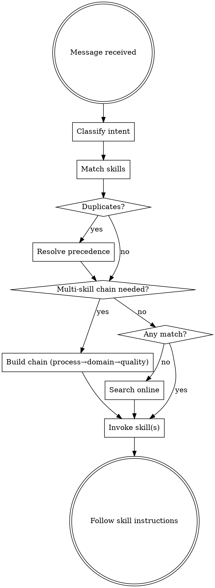

<SUBAGENT-STOP>
If you were dispatched as a subagent to execute a specific task, skip this skill.
</SUBAGENT-STOP>

# Skill Autopilot

## The Iron Law

```
EVERY user message gets skill-matched BEFORE you respond, write code, or ask questions.
```

This is not a suggestion. If a skill exists that could help — even 1% chance — invoke it.

## Decision Flowchart



## Phase 1: Classify Intent

Read the message. What is the user doing? Match against these **intent signals**:

| Signal | Intent |
|--------|--------|
| build, create, design, page, component, UI, layout, style | **Create UI** |
| fix, bug, error, broken, crash, not working, fails | **Debug** |
| plan, architect, complex, multi-step, "how should I" | **Plan** |
| review, audit, polish, check, accessibility, a11y | **QA/Review** |
| animate, motion, transition, hover, micro-interaction | **Animation** |
| optimize, slow, performance, bundle, render, memo | **Performance** |
| refactor, simplify, clean up, best practices | **Code Quality** |
| test, playwright, e2e, verify, screenshot | **Testing** |
| commit, push, PR, deploy, merge, ship | **Ship** |
| pdf, docx, pptx, xlsx, word, excel, slides, spreadsheet | **Documents** |
| image, logo, banner, art, poster, generate | **Media** |
| SEO, keywords, copy, headline, marketing, convert | **Marketing** |
| Claude API, Anthropic SDK, MCP, agent SDK | **AI/MCP** |
| twitter, reddit, product hunt, web search, scrape | **Research** |
| schema, migration, postgres, neon, SQL, database | **Database** |
| n8n, workflow, webhook, automation | **Automation** |
| SwiftUI, iOS, React Native, Flutter, mobile | **Mobile** |
| figma, design handoff, implement design | **Figma** |
| find skill, install skill, "is there a skill for" | **Discovery** |
| sentry, logging, tracing, metrics, monitoring | **Monitoring** |
| remotion, video | **Video** |
| domain, registrar, .com, .ai | **Domains** |
| shadcn, component registry | **Component Lib** |

Multiple intents can co-exist. "Build a landing page and deploy it" = Create UI + Ship.

## Phase 2: Resolve Duplicates

Many skills overlap. **Always use the winner.** Full precedence table: `references/precedence.md`

Quick rules:
- **Design skills** → `impeccable:*` wins over standalone and `document-skills:*`
- **Process skills** → `superpowers:*` wins over standalone
- **Document skills** → standalone wins over `document-skills:*` and `example-skills:*`
- **React/Next** → `react-best-practices` (standalone) = `vercel-react-best-practices` (pick one, not both)
- **Never invoke both** `document-skills:X` and `example-skills:X` — they're identical

## Phase 3: Build Skill Chain

Skills have a strict invocation order. **Process → Domain → Quality.**

| Phase | Skills | When |
|-------|--------|------|
| **1. Process** | `superpowers:brainstorming`, `superpowers:systematic-debugging`, `superpowers:writing-plans` | New features, bugs, complex tasks |
| **2. Domain** | `impeccable:frontend-design`, `design-system`, `react-best-practices`, `pdf`, `pptx`, etc. | The actual work |
| **3. Quality** | `impeccable:audit`, `impeccable:polish`, `superpowers:verification-before-completion` | After implementation |
| **4. Ship** | `superpowers:requesting-code-review`, `commit-commands:commit-push-pr`, `vercel:deploy` | Wrapping up |

Common chains — see `references/chains.md` for the full recipe book.

**Critical gate:** Process skills come FIRST. Do NOT invoke `impeccable:frontend-design` without `superpowers:brainstorming` first for new features. Do NOT invoke code fixes without `superpowers:systematic-debugging` first for bugs.

## Phase 4: No Match → Discover

If nothing in your installed inventory matches:

1. Run `npx skills find "<query>"` with 2-3 relevant keywords
2. Present results with install command: `npx skills add <pkg> -g -y`
3. If `npx skills` isn't available, try: `gh search repos "claude-code skill <topic>"`
4. If nothing found online, proceed with general capabilities

See `references/discovery.md` for the full workflow.

## Phase 5: Invoke

1. **Announce**: "Using [skill] for [purpose]"
2. **Invoke**: Call `Skill` tool with the winning skill name
3. **Follow**: Execute the skill's instructions exactly — skills are authoritative
4. **Chain**: If the skill's output names another skill, invoke that too

## Red Flags — You're Bypassing Autopilot

| Your Thought | Reality |
|--------------|---------|
| "Too simple for a skill" | Simple tasks have the most unexamined assumptions. Check. |
| "I'll check skills after" | Skills are checked BEFORE. Always. |
| "Let me just write the code" | Process skills (brainstorming, debugging) come before code. |
| "I already know this" | Skills have checklists you'll miss. Use them. |
| "No skill matches exactly" | Partial match > no match. Also search online. |
| "The user didn't ask for a skill" | Auto-invoked. Users never need to ask. |
| "I'll handle design myself" | impeccable skills exist. Use them. |
| "It's just a quick fix" | `systematic-debugging` exists for a reason. |
| "I know what that skill says" | Skills evolve. Invoke the current version. |

## Session Lifecycle

| Moment | Action |
|--------|--------|
| **Start** | Is this a new feature? → `superpowers:brainstorming`. Is there a plan? → `superpowers:executing-plans`. |
| **During** | Match domain skills to each sub-task as it arises. |
| **Before claiming done** | `superpowers:verification-before-completion` — ALWAYS. No exceptions. |
| **Before commit/PR** | `superpowers:requesting-code-review` → `commit-commands:commit-push-pr` |

## Always-On Context Skills

These fire automatically when their context is detected, regardless of intent:
- **`design-system`** — any project with design tokens + any visual change
- **`react-best-practices`** or **`next-best-practices`** — any React/Next.js code touch
